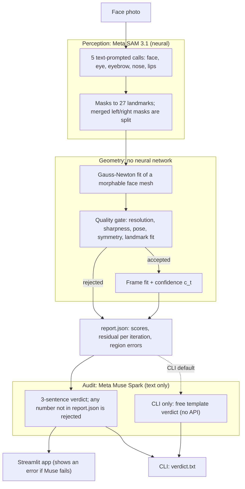

<h1 align="center">GAUSS LENS</h1>
<p align="center"><b>Neural perception, auditable geometry.</b></p>
<p align="center"><i>Perception · Fit · Audit</i></p>

---

Meta's **SAM 3.1** finds the facial regions in a photo. A **Gauss-Newton solver, with no neural network inside it,** fits a 3D face model to them and grades its own result. Meta's **Muse Spark** then writes a short plain-language verdict from the solver's own report, and its words are thrown away if they contain a number the solver did not produce.

GAUSS LENS fits a 3D morphable face model to a single face photo (a built-in synthetic model by default, or a BFM / FLAME-style 3DMM you supply) and reads off interpretable parameters: head pose, eye and mouth state, brow / nose / ear parameters. It ships as a Streamlit app and a command-line tool.

> **The claim is deliberately narrow:** no neural network in the 3D solve. It is not "no neural networks anywhere". SAM and Muse Spark are neural. The step that turns landmarks into head pose and face parameters is plain NumPy that you can read, log and test. `tests/test_no_network_in_solver.py` fails if any solver module imports an ML or API library.

## Why

Neural face trackers return numbers (head pose, mouth open or closed) but cannot say why they trust them, and cannot refuse a bad photo in a way you can inspect. We split the job:

* **Perception** (finding eyes, brows, nose, lips and face in a photo) is hard to write by hand, so a neural model does it.
* **The 3D result** comes from equations you can follow. Each run saves the residual after every iteration, five quality scores, and the error per face region, so you can see why a result was accepted or refused.

---

## Contents

1. [Quick start](#quick-start)
2. [Requirements and configuration](#requirements-and-configuration)
3. [Using the app](#using-the-app)
4. [What the pipeline does](#what-the-pipeline-does)
5. [Math in brief](#math-in-brief)
6. [Reading the results](#reading-the-results)
7. [Outputs and downloads](#outputs-and-downloads)
8. [Cost and safety limits](#cost-and-safety-limits)
9. [Example run](#example-run)
10. [What we measured](#what-we-measured)
11. [Tests](#tests)
12. [Roadmap](#roadmap)
13. [Troubleshooting](#troubleshooting)
14. [Project layout](#project-layout)
15. [CLI equivalent](#cli-equivalent)

---

## Quick start

```bash
# from the project root (Windows: .venv\Scripts\activate; macOS/Linux: source .venv/bin/activate)
python -m venv .venv
pip install -r requirements.txt
copy .env.example .env          # macOS/Linux: cp .env.example .env   then put your MODEL_API_KEY inside it
streamlit run app.py
```

Then: upload a photo → switch on **SAM 3.1** and **Muse Spark** → press **▶ Run Extraction**.

---

## Requirements and configuration

**Python packages** (all listed in `requirements.txt`; versions are lower bounds, not pinned):

|Package|Used for|
|-|-|
|`streamlit`|the UI|
|`numpy`|the whole solver|
|`pillow`|image loading / encoding|
|`scipy`|splitting merged SAM masks into blobs (`perception/landmarks.py`)|
|`pandas`|the residual-per-iteration chart|
|`python-dotenv`, `openai`|calling the Meta Model API (SAM 3.1, Muse Spark)|
|`meta-sam-parser` (`meta_sam_parser`)|decoding SAM's special-token output|

**Files that must sit together:** `app.py` (the UI), `run.py` (the CLI and shared helpers), and the
`face_params/` package.

**Environment variables** (put them in a `.env` file in the project root):

|Variable|Default|Meaning|
|-|-|-|
|`MODEL_API_KEY`|— (required)|Key for the Meta Model API; used by both SAM 3.1 and Muse Spark|
|`MUSE_MODEL`|`muse-spark-1.3`|Muse model name. Names ending in `-contributor` are blocked (they train on what you send, and this is a face)|
|`FACE_PARAMS_MAX_SAM_CALLS`|`40`|Hard cap on live SAM calls per process|
|`FACE_PARAMS_MAX_MUSE_CALLS`|`10`|Hard cap on live Muse calls per process|
|`FACE_PARAMS_SAM_CACHE`|`cache/sam`|Disk cache for SAM answers|
|`FACE_PARAMS_MUSE_CACHE`|`cache/muse`|Disk cache for Muse answers|
|`FACE_PARAMS_SAM_MAX_SIDE`|`2048`|Longest image side sent to the API (larger images are resized)|

---

## Using the app

### 1. Startup

An animated intro plays, then a title page whose bell-curve is the **real boot progress bar** (it tracks the
solver and pipeline modules loading). Press **READY ▶** to enter. A synthesized sound engine (Web Audio, no
audio files) plays effects such as the connect chime and failure buzzer.

### 2. Inputs

|Control|What it does|
|-|-|
|**Upload face image**|PNG, JPG, JPEG, BMP or WEBP. One clear, roughly frontal face works best|
|**Optional — upload 3DMM model (.npz)**|A real 3DMM (BFM / FLAME style). Without one the app uses the built-in reference model, so it runs anywhere|
|**Strict Stage-1 validation** (on by default)|Reject a source image whose validation scores are too low. Turn off to continue anyway (results are then unreliable)|
|**🔌 SAM 3.1 toggle**|Connects the face-part finder. Shows ✓ or an error with details|
|**🔌 Muse Spark toggle**|Connects the verdict writer|

**Both toggles must be on and connected before Run is allowed.** The app checks `MODEL_API_KEY` and shows the
reason if a connection fails (for example, "MODEL_API_KEY not found — put it in a `.env` file").

### 3. Run

Press **▶ Run Extraction**. A "fight card" loader plays while the pipeline runs, with a step tracker and
ticker. When it finishes, the results page appears.

> The UI is stricter than the CLI: the CLI defaults to template landmarks and a free template verdict, while
> the UI always uses SAM landmarks and a Muse verdict. If Muse fails, the UI shows the error rather than
> substituting text.

### 4. About panel

A collapsible panel (✕ to close, ▸ to reopen) with three tabs: **How it works**, **Flowchart**, **Math in brief**.

---

## What the pipeline does

A simplified view (the full version is in the app's **Flowchart** tab):



**Validation (Stage 1).** Every one of the five scores must be **above 0.60** (`ACCEPT_THRESHOLD`). The resolution score is
`min(1, smaller face side / 256 px)`, so the face must be at least about **154 px** across. Otherwise the image
is rejected and the app explains why.

**Quality gate (Phase 2).** Three scores (landmark fit, flow, pose) are combined into a confidence `c_t` (formula in [Math in brief](#math-in-brief)), which maps to a decision:

|`c_t`|Decision|
|-|-|
|above 0.75|PROCEED|
|0.40 – 0.75|CONSERVATIVE|
|below 0.40|FALLBACK|

With a single image there is no previous frame, so `s_flow` is fixed at 1.0 and the same image is used as
source and target.

**The verdict.** Muse Spark receives only `report.json` and writes at most three short sentences. Any reply
containing a number that is not in the report is discarded.

---

## Math in brief

**Fit (Stage 2).** Minimised by Gauss-Newton over the parameter vector Θ = [α β ω t ψ γ δ]:

```
E(Θ)  = w_app·E_app + Σ_i ‖ π(S_i; Θ) − x_i ‖² + E_reg      x_i = landmark from the SAM masks, π = camera projection
ΔΘ    = −(JᵀJ + λΛ)⁻¹ Jᵀ e ,   λ = 0.01                      a step is kept only if the residual drops (backtracking)
```

**Quality scores (Stage 1).** Each is in [0, 1]. The photo is accepted only if all five are above 0.60:

```
resolution = min(1, min(H_face, W_face) / 256)
sharpness  = min(1, ‖∇²I‖ / ‖∇²I_ref‖)                      Laplacian energy vs a sharp reference
pose       = exp(−(ω_y² + ω_x²) / 2σ²),   σ = 30°
symmetry   = 1 − ‖L_left − flip(L_right)‖ / (k · W_face)
landmark   = (1/N) Σ_i exp(−‖x_i − x̂_i‖² / 2σ_lm²),   σ_lm = max(3 px, 0.02 · W_face)
```

**Final decision (Phase 2).**

```
c_t = 0.5·s_lm + 0.3·s_flow + 0.2·s_pose
```

PROCEED above 0.75, CONSERVATIVE from 0.40 to 0.75, FALLBACK below 0.40. For a single photo there is no previous frame, so `s_flow = 1`.

**What is checked and what is measured.** Muse's reply is kept only if every number in it also appears in `report.json`. Mouth open/closed and eye openness are measured from the SAM masks (height ÷ width), not read from the fit.

> For the full derivations, symbol definitions and experiments, see the technical paper: [GAUSS LENS: Technical Paper](docs/technical-paper.pdf).

---

## Reading the results

The results page shows, in order:

* **Decision line** — decision and quality `c_t` in one line at the top.
* **Landmark overlay** — the fitted model's region vertices projected onto your photo, coloured by region
(eye, brow, nose, mouth, ear). The **baked UV texture** sits under it in a collapsed section (it has artefacts and is not part of the claim).
* **Head pose and per-region error** — yaw / pitch / roll in degrees; mean pixel error per region (eye, brow, nose, mouth, and ear when the model has ear points) and overall.
* **Residual per iteration** — the solver's convergence curve, with a **▶ Replay the solve** button.
* **Eye, mouth, nose and expression sections.**
* **Quality gate** — score, decision, mouth state and the explanation.
* **Curated log panel** — the verbose Gauss-Newton output collapsed into named sections (Phase 1: S1–S4;
Phase 2: prior, fit, quality gate; Phase 3: flow, motion state), with a **download of the full raw log**.
* **Verdict** — Muse Spark's plain-language summary, then the download buttons.

### Which numbers to trust

|Value|How it is obtained|Trust|
|-|-|-|
|Eye aspect (left / right)|SAM mask height ÷ width, measured|**High**|
|Mouth aspect and open / closed|SAM lips-mask height ÷ width (open if above 0.5), measured|**High**|
|Head pose|Fitted|Good for roughly frontal photos|
|Quality, per-region error|Fitted against landmarks derived from the SAM masks|Consistency of the fit with those landmarks|
|Fitted eye aperture / gaze, fitted mouth openness|Fitted|**Lower** — kept in the JSON under `*_fitted_unreliable` names|

When SAM masks are available, the app reports mask-measured eye and mouth values and demotes the fitted ones.

---

## Outputs and downloads

Buttons on the results page:

|Button|File|Contents|
|-|-|-|
|⬇ Parameters (JSON)|`face_params.json`|Same structure as the CLI's `summary.json`|
|⬇ Overlay PNG|`face_overlay.png`|The landmark overlay|
|⬇ UV texture PNG|`texture.png`|The baked texture|
|⬇ Download full raw log|`face_params_pipeline_log.txt`|Unabridged solver log|

The JSON contains: `quality`, `decision`, `head_pose_deg`, `eye`, `mouth_open`, `mouth_aspect`,
`region_error_px`, `sam_measures`, the `*_fitted_unreliable` values, and a `cost_usd` block.

The CLI additionally writes `phase1_params.npz`, `phase2_params.npz`, `report.json` and `verdict.txt`.

---

## Cost and safety limits

* A new image costs **5 live SAM calls** (about **$0.0125**) and **1 live Muse call** (about **$0.002**), so
roughly **$0.014 per run**.
* Every answer is **cached on disk** by image hash (SAM) or report hash (Muse). Re-running the same image
is free.
* Credit guards stop a process after the configured number of live calls (see the environment variables).
* Muse is **text only** and never sees the image — only the numeric report. A reply that quotes a number not in the report is discarded.
* Your photo is sent to **SAM 3.1** through the Meta Model API. Use synthetic or consenting faces only, and never commit photos, `.env` or `cache/` (the included `.gitignore` blocks them).
* Costs shown are estimates from the price table in the code.

---

## Example run

A single portrait photo, run with SAM 3.1 landmarks and the Muse Spark verdict (built-in synthetic model). The photo itself is not included in the repository.

### 🎬 Project Demo

Demo video: [▶ Watch GAUSS-LENS Demo](https://drive.google.com/file/d/1UPQdI1ihr3o_5gUsqMg8MeIuSQjYGdxs/view?usp=sharing)

|Item|Result|
|-|-|
|Validation (accepted)|landmark fit 0.982 · symmetry 0.998 · resolution 1.000 · sharpness 1.000 · pose 1.000|
|Decision / quality|**PROCEED**, 0.962|
|Head pose|yaw −0.2° · pitch +0.4° · roll −1.1°|
|Measured from masks|eye aspect L 0.402 / R 0.337 · mouth aspect 0.225 → **closed**|
|Region error (px)|all 4.3 · eye 1.5 · brow 3.3 · nose 3.9 · mouth 5.8|
|Solver residual|118.2 → 11.3 (**90.5 % lower**); most of the drop happens in the first three iterations, then it settles steadily|
|Cost|5 SAM calls + 1 Muse call ≈ **$0.014**|

Verdict written by Muse Spark:

> Decision is PROCEED, with the weakest validation check being landmark_consistency at 0.982.
> Head pose is yaw -0.2, pitch 0.4, roll -1.1 deg, and the mouth is closed with mouth_aspect 0.225.
> The solver stopped at its iteration cap at 10 of 10 iterations.

---

## What we measured

How the gates behave on different inputs (all runs with SAM 3.1 landmarks):

|Input|Result|
|-|-|
|Sharp frontal face|PROCEED, quality 0.962, region error 4.3 px, residual 118 to 11 (90% lower)|
|Same face, Gaussian blur 8 / 14|Still accepted (sharpness 0.681 / 0.627); the report names sharpness as the weakest check|
|Face about 79 px wide|**Rejected**: resolution 0.309, every other score passes; the verdict names the face size|
|Head turned about 40°|**Rejected**: landmark consistency 0.336|
|Same turned face with Strict off (`--no_strict`)|CONSERVATIVE, quality 0.572, eye error about 100 px; the verdict says validation failed and the result is unreliable|

Splitting merged left/right eye and brow masks cut the brow error from 10.4 px to 3.3 px. One real photograph was used only
locally for the resolution check; it is not in the repository.

---

## Tests

No API key and no network are needed:

```bash
python tests/test_smoke.py
python tests/test_sam_landmarks.py
python tests/test_audit.py
python tests/test_no_network_in_solver.py   # fails if a solver module imports an ML or API library (torch, tensorflow, onnx, openai, ...)
```

(With `pytest` installed, `python -m pytest -q tests` runs everything.)

---

## Roadmap

GAUSS LENS is under active development. Planned next, each with where it stands today:

* **Real 3DMM support out of the box.** Models in `.npz` form (BFM / FLAME style) can already be loaded; the built-in
model is synthetic so the pipeline runs anywhere. A bundled statistical model will give measurable 3D accuracy,
richer geometry and cleaner UV textures.
* **Landmarks that are independent evidence.** Today each region keeps the template's shape and is centred on its SAM mask,
so a low fit error shows the solver agrees with those landmarks. Adding more points per region from the mask outline
will make the fit error an independent check.
* **Non-frontal faces.** Today a head turned about 40° is rejected, and the fitted yaw is not reliable on turned faces
(it read −6.3° on a 40° turn). Better pose initialisation and visibility-aware regions (parts hidden by a turn or by
hair are detected and dropped) will let the fit rely only on what is visible.
* **Calibrated validation scores.** Today sharpness is compared with a synthetic reference and a heavy blur still passes
the 0.60 threshold. A sharper reference and a recalibrated pose score will separate good and poor photos more finely.
* **Mask confidence as solver weights.** SAM's mask scores do not yet come through the parser, so all landmarks count equally.
Once they do, they become the weights `w_i` in the fit.
* **Eyes and mouth from the fit.** Eye and mouth state are read from the SAM masks, because the fitted aperture, gaze and mouth
openness are poorly determined from one image. More landmarks per eye and lip will make them usable.
* **Faster, fully converged solves.** The solver currently stops at its 10-iteration cap with the residual still falling slowly
(the report and verdict say so), and the source fit is computed more than once per run. Caching it and raising the cap
will cut run time and reach convergence.
* **Video mode in the UI.** Phase 2 and 3 tracking already exist in the code; exposing them for multi-frame input is planned.

---

## Troubleshooting

|Symptom|Cause / fix|
|-|-|
|Run button disabled|Upload an image first|
|"Run not started — connect both models first"|Switch on both toggles and fix whichever shows an error|
|"MODEL_API_KEY not found"|Create a `.env` in the project root containing `MODEL_API_KEY=...`|
|`ModuleNotFoundError: pandas` (or another package)|Run `pip install -r requirements.txt` again|
|`ModuleNotFoundError: meta_sam_parser`|Install `meta-sam-parser`; the SAM path needs it, the CLI template mode does not|
|"SAM credit guard: N live calls already made"|Raise `FACE_PARAMS_MAX_SAM_CALLS` if intended|
|Image rejected at Stage 1|Use a larger (face at least ~154 px across, ideally 256 px or more), sharper, frontal photo, or untick **Strict**|
|"SAM found no face in the image"|The face mask came back empty; try a clearer, closer photo|
|"Only N landmarks from SAM"|Too few regions found (need at least 8); the log lists missing regions|
|Verdict shows an error|Muse call failed or its reply quoted numbers not in the report; check key, model name and call cap|
|Cache folders appear in the working directory|`cache/sam` and `cache/muse` are created on import; set the cache env vars to move them|

---

## Project layout

```
app.py                         Streamlit UI
run.py                         CLI entry point + model loader, symmetry pairs, session builder
face_params/
  pipeline.py                  orchestrator: Phase 1 → 2 → 3
  shape_model.py               3DMM and regional sub-models, state vectors
  geometry.py                  Rodrigues, projection, Jacobian building blocks
  extractor.py                 FaceParams result container (+ a simple FaceParamExtractor API)
  io_utils.py, mesh_utils.py, texture_utils.py, synthetic_model.py
  face_recogniser/             starting landmarks + first Gauss-Newton fit
  phase1/                      stage1_validation, stage2_gn_source, stage3_rasterise, stage4_target_neutral
  phase2/per_frame_tracking.py frame fit and quality gate
  phase3/tracking.py           optical flow and velocity update
  perception/                  sam_client (API + cache), landmarks (masks → landmarks)
  audit/                       report.py (report.json), verdict.py (template / Muse Spark)
```

---

## CLI equivalent

```bash
python run.py --image face.png                                   # synthetic model, template landmarks
python run.py --image face.png --landmarks sam --verdict muse    # real SAM landmarks + Muse verdict
python run.py --image face.png --model bfm.npz --out_dir out/
python run.py --image small.png --no_strict                      # continue past a Stage-1 rejection
```

Outputs go to `--out_dir` (default `extract_out/`): `phase1_params.npz`, `phase2_params.npz`,
`texture.png`, `overlay.png`, `summary.json`, `report.json`, `verdict.txt`.

The CLI default (`--landmarks model`) is a quick offline mode that uses the template's own landmarks; use
`--landmarks sam` to fit to evidence from the photo.
